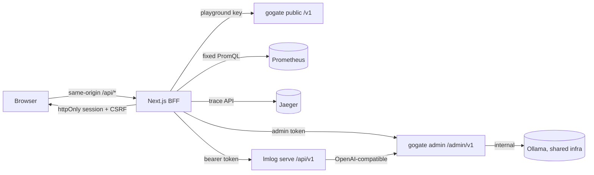

# ops-console

[](https://github.com/yugrinovD/ops-console/actions/workflows/ci.yml)
[](LICENSE)


**A web console for gogate and lmlog: metrics, streaming playground, keys and quotas, log analysis and traces.**

**Part of [AI Ops Stack](https://github.com/yugrinovD/ai-ops-stack):**
[gogate](https://github.com/yugrinovD/gogate) ·
[lmlog](https://github.com/yugrinovD/lmlog) ·
[ops-console](https://github.com/yugrinovD/ops-console) ·
[ledger](https://github.com/yugrinovD/ledger) ·
[ai-ops-stack](https://github.com/yugrinovD/ai-ops-stack).

`ops-console` is a Next.js BFF application that gives one operational surface for
the `gogate` AI gateway and the `lmlog` log intelligence tool. The browser only
talks to same-origin `/api/*`; admin tokens, provider keys and lmlog tokens stay
on the server.

[Русская версия](README.md)


---

## Features

- **Dashboard**: RPS, p50/p95/p99, 5xx rate, tokens, cost, cache hit share,
  rate limited, top models and tenants; 15m/1h/6h/24h/7d ranges.
- **Playground**: model selection, temperature, max tokens, system prompt,
  SSE streaming, provider/fallback chain, `request_id`, usage and cost.
- **Keys & quotas**: create/revoke keys, show plaintext once, RPM/TPM,
  daily/monthly limits and per-key usage.
- **Logs**: upload `.log/.txt/.jsonl`, SSE progress, signatures, error clusters,
  trends, explain and grounded chat over a snapshot.
- **Requests & traces**: audit filters, latency, provider/cache and an exact
  Jaeger span waterfall for persisted `trace_id`.
- **Alerts**: threshold rules over live metrics, active alerts on the dashboard.
- **Compare**: one prompt, 2–3 models, latency/tokens/cost and per-metric winners.
- **Export**: CSV for dashboard, requests, signatures, errors and trends.
- **RBAC**: admin and viewer, enforced server-side.
- **Dark/light theme**, command palette, responsive layout and accessible states.

---

## Architecture



- The browser never calls admin/public APIs directly.
- Secrets are read only in server-only modules (`import "server-only"`).
- First data is server-rendered; interactivity, filters and streaming are client-side.
- Upstream failures become one `{ error: { code, message, requestId } }` envelope.
- SSE streams are proxied with abort, heartbeats and `Last-Event-ID`.

See [docs/DESIGN.md](docs/DESIGN.md) and [docs/SECURITY.md](docs/SECURITY.md).

---

## Screenshots

| | |
| --- | --- |
|  |  |
|  |  |
|  |  |

---

## Quick start

### 1. gogate

```bash
cd ../gogate
make demo
```

The demo starts PostgreSQL, Redis, gogate, Prometheus, Grafana and Jaeger and
creates a demo key in `build/demo-key.txt`. The admin token is in gogate's `.env`.

### 2. lmlog serve

```bash
cd ../lmlog
python3 -m venv .venv
source .venv/bin/activate
pip install -e ".[serve]"

export LMLOG_API_TOKEN="$(openssl rand -hex 32)"
lmlog serve --host 127.0.0.1 --port 8090
```

AI explanations and chat go through `lmlog → gogate → Ollama`. `ops-console`
never talks to Ollama; it only knows `gogate` and `lmlog`. The full stack starts
Ollama in `ai-ops-stack/`; standalone lmlog can use `LMLOG_LLM_MODE=direct`. When no LLM
is available, lmlog returns deterministic heuristics and the console keeps
working.

### 3. ops-console

```bash
cp .env.example .env.local
# set CONSOLE_AUTH_TOKEN, GOGATE_ADMIN_TOKEN,
# GOGATE_PLAYGROUND_API_KEY and LMLOG_API_TOKEN
npm ci
npm run dev
```

Open `http://localhost:3100` and sign in with `CONSOLE_AUTH_TOKEN`.
Viewer access is enabled by `CONSOLE_VIEWER_TOKEN`.

### Docker

```bash
cp .env.example .env
# Inside the container use host.docker.internal for local services:
#   GOGATE_ADMIN_URL=http://host.docker.internal:9090
#   GOGATE_PUBLIC_URL=http://host.docker.internal:8080
#   PROMETHEUS_URL=http://host.docker.internal:9092
#   GOGATE_JAEGER_URL=http://host.docker.internal:16686
#   LMLOG_API_URL=http://host.docker.internal:8090
docker compose up -d --build
```

The console is available at `http://localhost:3100`; alert data is persisted in
the `ops-console_console-data` volume.

---

## Configuration

| Variable | Required | Description |
| --- | --- | --- |
| `CONSOLE_AUTH_TOKEN` | yes | administrator token |
| `CONSOLE_VIEWER_TOKEN` | no | read-only token |
| `CONSOLE_SESSION_SECRET` | no | session HMAC secret; derived from the auth token |
| `CONSOLE_ORIGIN` | yes | public origin for CSRF and cookies |
| `CONSOLE_COOKIE_SECURE` | no | `true` for HTTPS; otherwise derived from the origin |
| `CONSOLE_DATA_DIR` | no | `alerts.json` directory (default `./data`) |
| `CONSOLE_LOG_LEVEL` | no | `info`, `warn`, `debug` |
| `GOGATE_ADMIN_URL` | for P0/P1 | admin listener |
| `GOGATE_ADMIN_TOKEN` | for P0/P1 | admin bearer token |
| `GOGATE_PUBLIC_URL` | for playground | public listener |
| `GOGATE_PLAYGROUND_API_KEY` | for playground | server-side gateway key |
| `GOGATE_JAEGER_URL` | for traces | Jaeger UI/API |
| `GOGATE_JAEGER_SERVICE` | no | Jaeger service name, default `gogate` |
| `PROMETHEUS_URL` | for live metrics | Prometheus HTTP API |
| `PROMETHEUS_BEARER_TOKEN` | no | Prometheus bearer token |
| `JAEGER_BEARER_TOKEN` | no | Jaeger bearer token |
| `LMLOG_API_URL` | for logs | `lmlog serve` |
| `LMLOG_API_TOKEN` | for logs | lmlog bearer token |
| `LMLOG_MAX_UPLOAD_MB` | no | client/server upload limit, default 50 |

Full template: [.env.example](.env.example).

---

## BFF API

| Method | Path | Purpose |
| --- | --- | --- |
| `POST` | `/api/auth/login` | token login, httpOnly session |
| `POST` | `/api/auth/logout` | logout |
| `GET` | `/api/health` | gogate/lmlog/Prometheus/Jaeger health |
| `GET` | `/api/dashboard` | metrics + usage + alerts |
| `GET` | `/api/models` | models, providers, prices |
| `POST` | `/api/playground` | JSON or normalised SSE |
| `POST` | `/api/playground/compare` | parallel model comparison |
| `GET/POST` | `/api/keys`, `/api/tenants`, `/api/quotas` | control plane |
| `GET` | `/api/usage/keys` | per-key usage |
| `GET` | `/api/requests` | audit with filters |
| `GET` | `/api/traces/{id}` | span waterfall |
| `POST` | `/api/lmlog/jobs` | upload to lmlog |
| `GET` | `/api/lmlog/jobs/{id}/events` | SSE proxy |
| `GET` | `/api/lmlog/snapshots/{id}/*` | snapshot, signatures, errors, trends |
| `POST` | `/api/lmlog/explain`, `/api/lmlog/chat` | explain and grounded chat |
| `GET/POST/PUT/DELETE` | `/api/alerts` | alert rules |
| `GET` | `/api/export/*` | CSV export |

Contracts and SSE events: [docs/CONTRACTS.md](docs/CONTRACTS.md).

---

## Security

- `CONSOLE_AUTH_TOKEN` is compared in constant time.
- The session is an HMAC-signed httpOnly cookie (`SameSite=Lax`, expiry).
- Mutations require `Origin`, `Sec-Fetch-Site` and a double-submit CSRF token.
- RBAC is enforced on the server, not only in the UI.
- CSP with a nonce, `frame-ancestors 'none'`, `nosniff`, HSTS.
- Admin/public/lmlog tokens never reach the client bundle, logs or responses.
- LLM output is rendered through sanitised Markdown.
- lmlog uploads use an extension allowlist, a size limit and generated storage names.

See [docs/SECURITY.md](docs/SECURITY.md).

---

## Tests

```bash
npm test          # Vitest + RTL + MSW
npm run typecheck
npm run lint
npm run build
npm run test:e2e  # Playwright + mock upstreams
```

E2E starts `scripts/mock-upstreams.mjs` (gogate/Prometheus/Jaeger/lmlog) and
`next start` on `:3101`, so no real services are required.

See [docs/TESTING.md](docs/TESTING.md).

---

## Limitations

- Live RPS/latency require Prometheus; without it the dashboard degrades to usage.
- The Jaeger waterfall requires tracing to be enabled and the trace to be sampled.
- gogate's admin API does not expose live RPM/TPM counters; the console shows
  configured limits and daily/monthly usage.
- lmlog chat is not RAG: top-N signatures plus the selected cluster.
- `lmlog serve` is single-process; jobs and SSE subscribers live in memory.
- Alerts are evaluated when the dashboard loads and do not send external notifications.
- Auth is one admin and an optional viewer token, not a full IdP.
- Login/playground rate limits are in-memory and intended for one instance.

---

## Documentation

- [DESIGN.md](docs/DESIGN.md) — architecture and trade-offs.
- [SECURITY.md](docs/SECURITY.md) — threat model and mitigations.
- [OPERATIONS.md](docs/OPERATIONS.md) — deployment, env, troubleshooting.
- [TESTING.md](docs/TESTING.md) — test pyramid and E2E harness.
- [CONTRACTS.md](docs/CONTRACTS.md) — API contracts and SSE.
- [ADR](docs/adr/) — architecture decisions.

## License

MIT. See [LICENSE](LICENSE).
