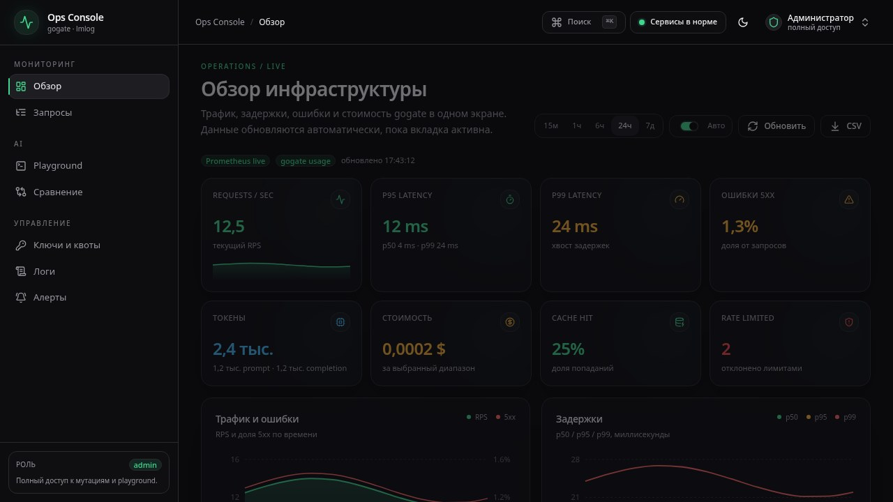
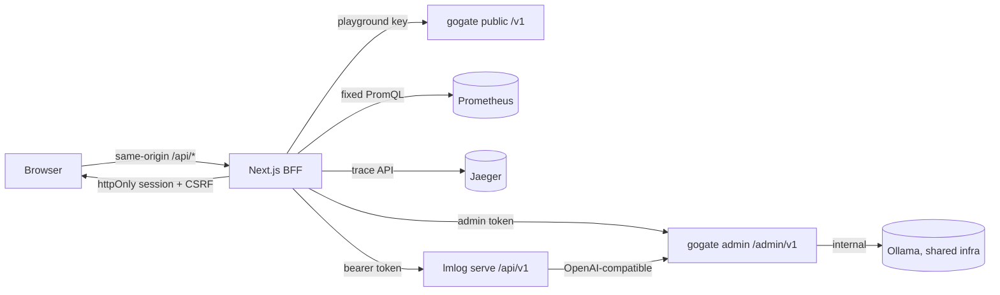
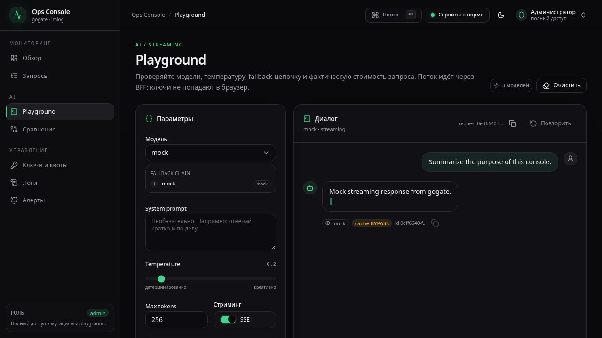
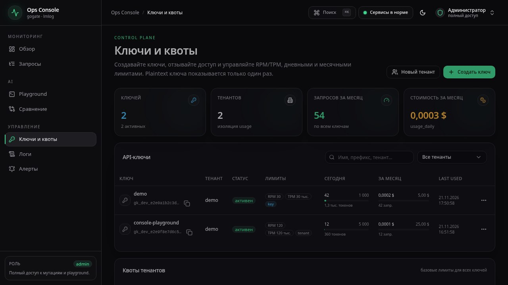
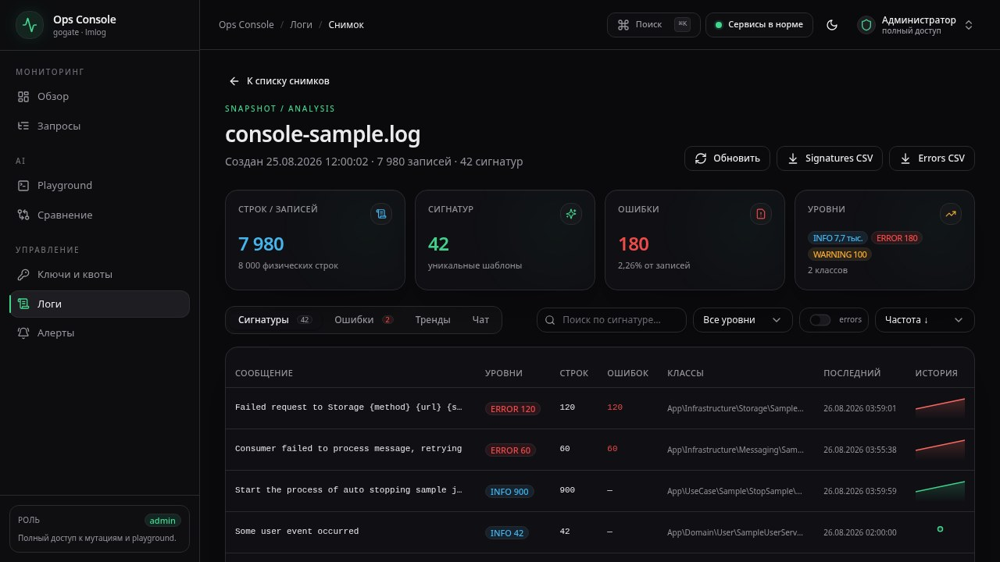
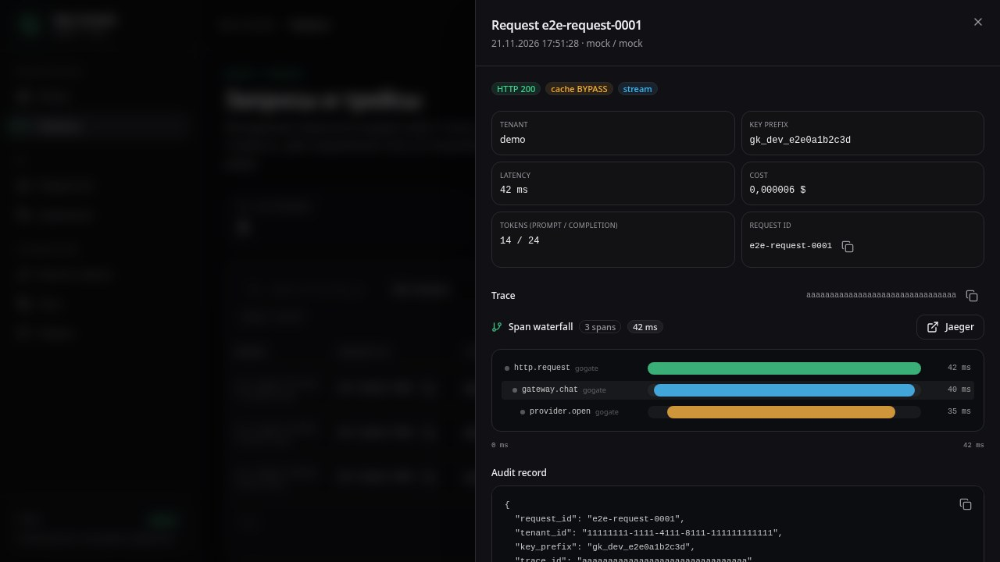
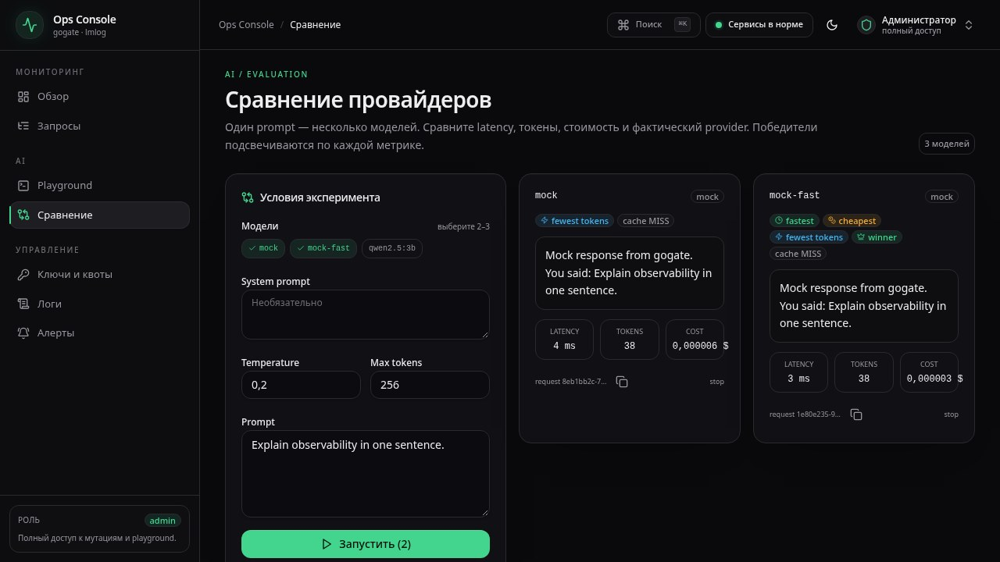
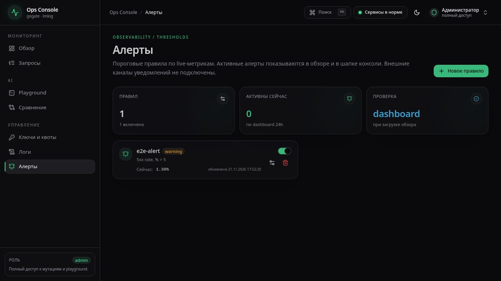

# ops-console

[](https://github.com/yugrinovD/ops-console/actions/workflows/ci.yml)
[](LICENSE)
[](https://github.com/yugrinovD/ops-console/releases)


**A web console for gogate and lmlog: metrics, a streaming playground, keys and
quotas, log analysis and traces.**

**Part of [AI Ops Stack](https://github.com/yugrinovD/ai-ops-stack):**
[gogate](https://github.com/yugrinovD/gogate) ·
[lmlog](https://github.com/yugrinovD/lmlog) ·
[ops-console](https://github.com/yugrinovD/ops-console) ·
[ledger](https://github.com/yugrinovD/ledger) ·
[ai-ops-stack](https://github.com/yugrinovD/ai-ops-stack).

[Русская версия](README.md) · [Changelog](CHANGELOG.md)

I built it so I would stop jumping between a terminal, Grafana and Jaeger while
debugging one request. Now it is one page: traffic, keys, logs, traces and a
small playground for checking a model without curl.

`ops-console` is a Next.js BFF. The browser only talks to same-origin `/api/*`;
admin tokens, provider keys and lmlog tokens stay on the server.



## Features

- **Dashboard**: RPS, p50/p95/p99, 5xx, tokens, cost, cache hit, rate limited,
  top models and tenants.
- **Playground**: model, temperature, max tokens, system prompt, SSE,
  provider/fallback chain, usage and cost.
- **Keys & quotas**: create and revoke keys, show plaintext once, RPM/TPM,
  daily and monthly limits.
- **Logs**: upload `.log/.txt/.jsonl`, SSE progress, signatures, error clusters,
  trends, explain and chat over a snapshot.
- **Requests & traces**: audit filters, latency, provider/cache and an exact
  Jaeger span waterfall for a `trace_id`.
- **Alerts and Compare**: threshold rules over metrics and 2–3 models on one
  prompt.
- **Export**: CSV for dashboard, requests, signatures, errors and trends.
- **RBAC**: admin and viewer, enforced server-side.

## Architecture



The browser never calls admin/public APIs directly. Secrets are read only in
server-only modules. Upstream failures become one
`{ error: { code, message, requestId } }` envelope. SSE is proxied with abort,
heartbeats and `Last-Event-ID`.

More: [docs/DESIGN.md](docs/DESIGN.md) and
[docs/SECURITY.md](docs/SECURITY.md).

## Screenshots

| | |
| --- | --- |
|  |  |
|  |  |
|  |  |

## Quick start

The easiest path is the full stack from
[ai-ops-stack](https://github.com/yugrinovD/ai-ops-stack): `make up` starts
gogate, lmlog, Ollama, Prometheus, Grafana, Jaeger and the console.

If you want to run things separately:

```bash
# 1. gogate
cd ../gogate && make demo

# 2. lmlog serve
cd ../lmlog
python3 -m venv .venv && source .venv/bin/activate
pip install -e ".[serve]"
export LMLOG_API_TOKEN="$(openssl rand -hex 32)"
lmlog serve --host 127.0.0.1 --port 8090

# 3. console
cd ../ops-console
cp .env.example .env.local
# CONSOLE_AUTH_TOKEN, GOGATE_ADMIN_TOKEN,
# GOGATE_PLAYGROUND_API_KEY, LMLOG_API_TOKEN
npm ci
npm run dev
```

Open `http://localhost:3100` and sign in with `CONSOLE_AUTH_TOKEN`. Viewer access
is enabled with `CONSOLE_VIEWER_TOKEN`.

The Docker path is described in [.env.example](.env.example) and
[docs/OPERATIONS.md](docs/OPERATIONS.md).

## Configuration

| Variable | Required | Why |
| --- | --- | --- |
| `CONSOLE_AUTH_TOKEN` | yes | admin token |
| `CONSOLE_VIEWER_TOKEN` | no | read-only token |
| `CONSOLE_SESSION_SECRET` | no | HMAC session secret |
| `CONSOLE_ORIGIN` | yes | origin for CSRF and cookies |
| `GOGATE_ADMIN_URL` / `GOGATE_ADMIN_TOKEN` | yes | gogate admin API |
| `GOGATE_PUBLIC_URL` / `GOGATE_PLAYGROUND_API_KEY` | for playground | gogate public API |
| `PROMETHEUS_URL` | for live metrics | Prometheus HTTP API |
| `GOGATE_JAEGER_URL` | for traces | Jaeger API |
| `LMLOG_API_URL` / `LMLOG_API_TOKEN` | for logs | `lmlog serve` |

The rest is in [.env.example](.env.example). BFF and SSE contracts:
[docs/CONTRACTS.md](docs/CONTRACTS.md).

## Security

- `CONSOLE_AUTH_TOKEN` is compared in constant time.
- The session is an HMAC-signed httpOnly cookie (`SameSite=Lax`, expiry).
- Mutations are protected by `Origin`, `Sec-Fetch-Site` and double-submit CSRF.
- RBAC is enforced on the server, not only in the UI.
- CSP with nonce, `frame-ancestors 'none'`, `nosniff`, HSTS.
- Admin/public/lmlog tokens never reach the client bundle, logs or responses.
- LLM output is rendered as sanitized Markdown.
- Log uploads use an extension allowlist, a size limit and generated filenames.

## Tests

```bash
npm test          # Vitest + RTL + MSW
npm run typecheck
npm run lint
npm run build
npm run test:e2e  # Playwright + mock upstreams
```

E2E starts `scripts/mock-upstreams.mjs` and `next start` on `:3101`, so real
services are not needed. More: [docs/TESTING.md](docs/TESTING.md).

## Limitations

- Live RPS/latency need Prometheus; without it the dashboard falls back to usage
  only.
- The Jaeger waterfall needs tracing enabled and a retained sample.
- The gogate admin API does not expose live RPM/TPM counters; the console shows
  configured limits and daily/monthly usage.
- lmlog chat is not RAG: top-N signatures plus the selected cluster.
- `lmlog serve` is single-process; jobs and SSE queues live in memory.
- Alerts are evaluated when the dashboard loads and do not send external
  notifications.
- Auth is one admin token and an optional viewer token, not an IdP.
- Login and playground rate limits are in-memory and assume one instance.

## Docs

- [DESIGN.md](docs/DESIGN.md) — architecture
- [SECURITY.md](docs/SECURITY.md) — threat model
- [OPERATIONS.md](docs/OPERATIONS.md) — running and troubleshooting
- [TESTING.md](docs/TESTING.md) — test pyramid
- [CONTRACTS.md](docs/CONTRACTS.md) — BFF API and SSE
- [ADR](docs/adr/) — decisions

## License

MIT. See [LICENSE](LICENSE).
