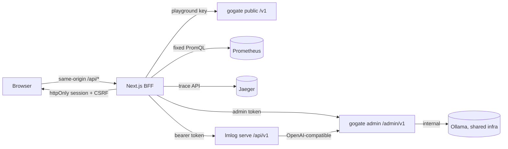
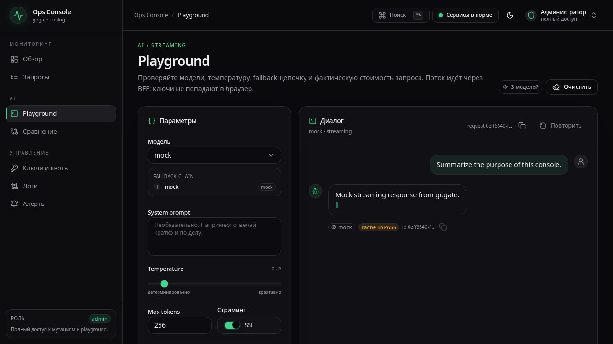

# ops-console

[](https://github.com/yugrinovD/ops-console/actions/workflows/ci.yml)
[](LICENSE)
[](https://github.com/yugrinovD/ops-console/releases)


**Веб-консоль для gogate и lmlog: метрики, streaming playground, ключи и квоты,
разбор логов и трейсы.**

**Part of [AI Ops Stack](https://github.com/yugrinovD/ai-ops-stack):**
[gogate](https://github.com/yugrinovD/gogate) ·
[lmlog](https://github.com/yugrinovD/lmlog) ·
[ops-console](https://github.com/yugrinovD/ops-console) ·
[ledger](https://github.com/yugrinovD/ledger) ·
[ai-ops-stack](https://github.com/yugrinovD/ai-ops-stack).

[English version](README.en.md) · [Changelog](CHANGELOG.md)

Сделал, чтобы не прыгать между терминалом, Grafana и Jaeger при разборе очередного
запроса. Теперь это одна страница: трафик, ключи, логи, трейсы и небольшой
playground, чтобы проверить модель без curl.

`ops-console` — Next.js BFF. Браузер общается только с same-origin `/api/*`;
admin-токены, ключи провайдеров и токены lmlog остаются на сервере.


## Что внутри

- **Dashboard**: RPS, p50/p95/p99, 5xx, токены, стоимость, cache hit, rate
  limited, top models и tenants.
- **Playground**: модель, temperature, max tokens, system prompt, SSE,
  provider/fallback chain, usage и стоимость.
- **Keys & quotas**: создание и отзыв ключей, plaintext один раз, RPM/TPM,
  дневные и месячные лимиты.
- **Logs**: загрузка `.log/.txt/.jsonl`, SSE-прогресс, сигнатуры, ERROR-кластеры,
  тренды, explain и чат по снимку.
- **Requests & traces**: audit-фильтры, latency, provider/cache и span waterfall
  из Jaeger по `trace_id`.
- **Alerts и Compare**: пороговые правила по метрикам и сравнение 2–3 моделей
  на одном prompt.
- **Export**: CSV для dashboard, запросов, сигнатур, ошибок и трендов.
- **RBAC**: admin и viewer, проверка ролей на сервере.

## Архитектура



Браузер не ходит в admin/public API напрямую. Секреты читаются только в
server-only модулях. Ошибки upstream приводятся к одному
`{ error: { code, message, requestId } }`. SSE проксируется с abort, heartbeat и
`Last-Event-ID`.

Подробнее: [docs/DESIGN.md](docs/DESIGN.md) и
[docs/SECURITY.md](docs/SECURITY.md).

## Скриншоты

| | |
| --- | --- |
|  |  |
|  |  |
|  |  |

## Быстрый старт

Проще всего поднять полный стек из
[ai-ops-stack](https://github.com/yugrinovD/ai-ops-stack): `make up` поднимет
gogate, lmlog, Ollama, Prometheus, Grafana, Jaeger и консоль.

Если хочется по отдельности:

```bash
# 1. gogate
cd ../gogate && make demo

# 2. lmlog serve
cd ../lmlog
python3 -m venv .venv && source .venv/bin/activate
pip install -e ".[serve]"
export LMLOG_API_TOKEN="$(openssl rand -hex 32)"
lmlog serve --host 127.0.0.1 --port 8090

# 3. консоль
cd ../ops-console
cp .env.example .env.local
# CONSOLE_AUTH_TOKEN, GOGATE_ADMIN_TOKEN,
# GOGATE_PLAYGROUND_API_KEY, LMLOG_API_TOKEN
npm ci
npm run dev
```

Откройте `http://localhost:3100` и войдите токеном `CONSOLE_AUTH_TOKEN`.
Viewer-доступ включается `CONSOLE_VIEWER_TOKEN`.

Docker-вариант описан в [.env.example](.env.example) и
[docs/OPERATIONS.md](docs/OPERATIONS.md).

## Конфигурация

| Переменная | Обязательна | Зачем |
| --- | --- | --- |
| `CONSOLE_AUTH_TOKEN` | да | токен администратора |
| `CONSOLE_VIEWER_TOKEN` | нет | read-only токен |
| `CONSOLE_SESSION_SECRET` | нет | HMAC-секрет сессии |
| `CONSOLE_ORIGIN` | да | origin для CSRF и cookie |
| `GOGATE_ADMIN_URL` / `GOGATE_ADMIN_TOKEN` | да | admin API gogate |
| `GOGATE_PUBLIC_URL` / `GOGATE_PLAYGROUND_API_KEY` | для playground | public API gogate |
| `PROMETHEUS_URL` | для live-метрик | Prometheus HTTP API |
| `GOGATE_JAEGER_URL` | для traces | Jaeger API |
| `LMLOG_API_URL` / `LMLOG_API_TOKEN` | для logs | `lmlog serve` |

Остальное — в [.env.example](.env.example). Контракты BFF и SSE:
[docs/CONTRACTS.md](docs/CONTRACTS.md).

## Безопасность

- `CONSOLE_AUTH_TOKEN` сравнивается constant-time.
- Сессия — HMAC-подписанная httpOnly-cookie (`SameSite=Lax`, expiry).
- Мутации защищены `Origin`, `Sec-Fetch-Site` и double-submit CSRF.
- RBAC проверяется на сервере, не только в UI.
- CSP с nonce, `frame-ancestors 'none'`, `nosniff`, HSTS.
- Admin/public/lmlog токены не попадают в клиентский bundle, логи и ответы.
- LLM-вывод рендерится через sanitized Markdown.
- Загрузки lmlog: allowlist расширений, лимит размера, сгенерированные имена.

## Тесты

```bash
npm test          # Vitest + RTL + MSW
npm run typecheck
npm run lint
npm run build
npm run test:e2e  # Playwright + mock upstreams
```

E2E поднимает `scripts/mock-upstreams.mjs` и `next start` на `:3101`, поэтому
реальные сервисы не нужны. Подробнее: [docs/TESTING.md](docs/TESTING.md).

## Ограничения

- Live RPS/latency требуют Prometheus; без него dashboard показывает только
  usage.
- Jaeger waterfall требует включённого tracing и сохранённого сэмпла.
- Admin API gogate не отдаёт live RPM/TPM-счётчики; видны настроенные лимиты и
  daily/monthly usage.
- Чат lmlog не использует RAG: top-N сигнатур + выбранный кластер.
- `lmlog serve` — single-process, задания и SSE-очереди в памяти.
- Alerts считаются при загрузке dashboard и не отправляют внешние уведомления.
- Auth — один admin и опциональный viewer, не IdP.
- Rate limit логина и playground — in-memory, на один инстанс.

## Документация

- [DESIGN.md](docs/DESIGN.md) — архитектура
- [SECURITY.md](docs/SECURITY.md) — threat model
- [OPERATIONS.md](docs/OPERATIONS.md) — запуск и troubleshooting
- [TESTING.md](docs/TESTING.md) — тесты
- [CONTRACTS.md](docs/CONTRACTS.md) — BFF API и SSE
- [ADR](docs/adr/) — решения

## Лицензия

MIT. См. [LICENSE](LICENSE).
