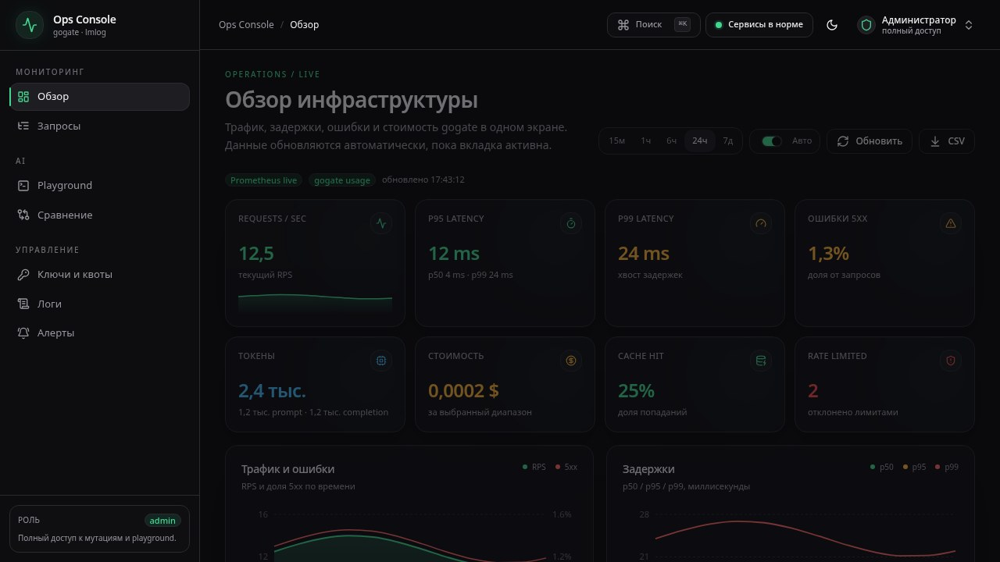
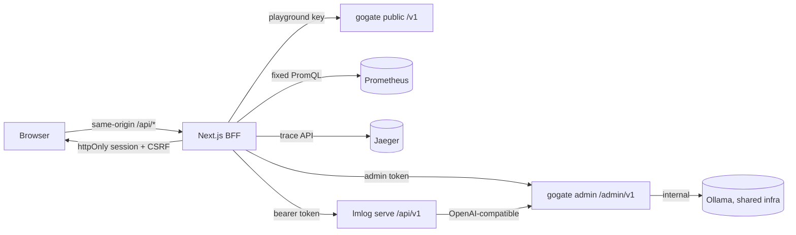
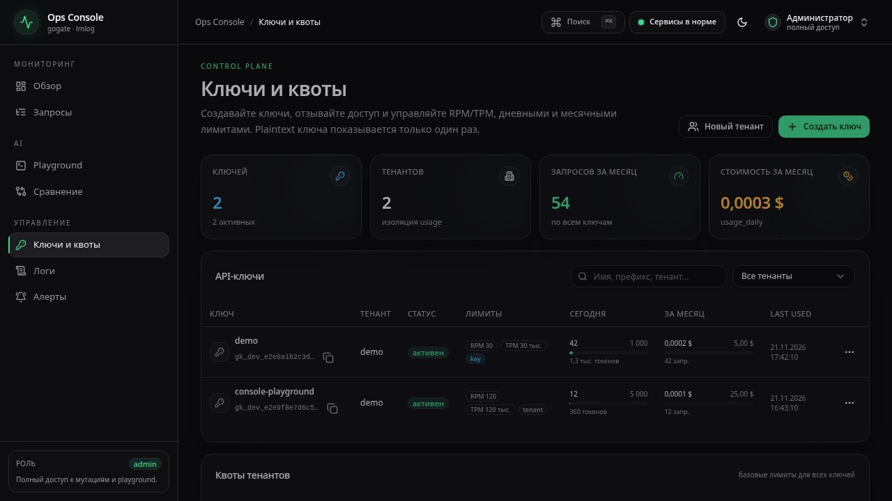
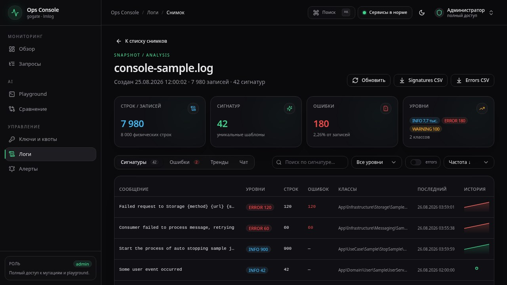
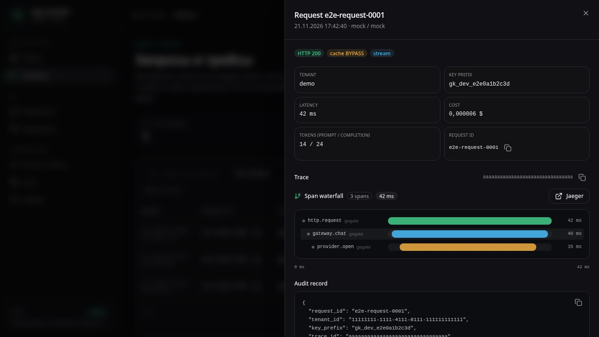
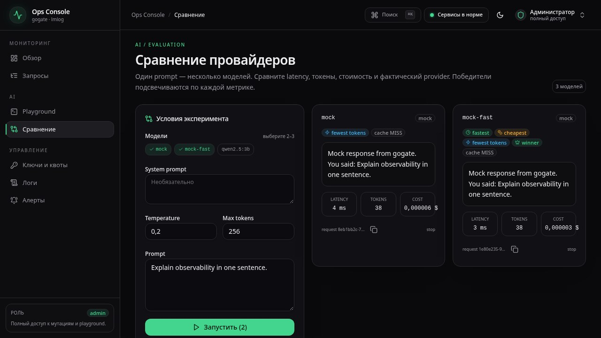
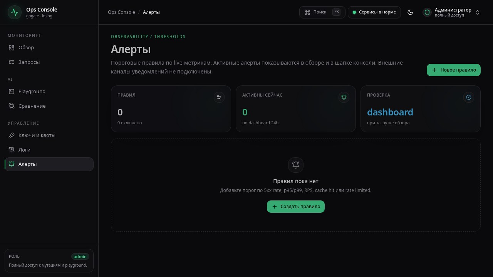

# ops-console

[](https://github.com/yugrinovD/ops-console/actions/workflows/ci.yml)
[](LICENSE)


**Веб-консоль для gogate и lmlog: метрики, streaming playground, ключи и квоты, разбор логов и трейсы.**

**Part of [AI Ops Stack](https://github.com/yugrinovD/ai-ops-stack):**
[gogate](https://github.com/yugrinovD/gogate) ·
[lmlog](https://github.com/yugrinovD/lmlog) ·
[ops-console](https://github.com/yugrinovD/ops-console) ·
[ledger](https://github.com/yugrinovD/ledger) ·
[ai-ops-stack](https://github.com/yugrinovD/ai-ops-stack).

`ops-console` — Next.js BFF-приложение, которое даёт одну операционную поверхность
для AI-шлюза `gogate` и анализатора логов `lmlog`. Браузер общается только с
same-origin `/api/*`; admin-токены, ключи провайдеров и токены lmlog остаются на
сервере.

[English version](README.en.md)



---

## Возможности

- **Dashboard**: RPS, p50/p95/p99, 5xx rate, токены, стоимость, cache hit,
  rate limited, top models и top tenants; диапазоны 15m/1h/6h/24h/7d.
- **Playground**: выбор модели, temperature, max tokens, system prompt,
  SSE-стриминг, provider/fallback chain, `request_id`, usage и стоимость.
- **Keys & quotas**: создание/отзыв ключей, plaintext один раз, RPM/TPM,
  дневные и месячные лимиты, текущий usage по ключам.
- **Logs**: загрузка `.log/.txt/.jsonl`, SSE-прогресс, сигнатуры, ERROR-кластеры,
  тренды, explain и grounded-чат по снимку; AI-вызовы идут через `lmlog` →
  `gogate`, консоль не знает про Ollama.
- **Requests & traces**: audit-фильтры, latency, provider/cache, точный
  span waterfall из Jaeger по `trace_id`.
- **Alerts**: пороговые правила по live-метрикам, активные алерты в обзоре.
- **Compare**: один prompt — 2–3 модели, latency/tokens/cost и победители.
- **Export**: CSV для dashboard, запросов, сигнатур, ошибок и трендов.
- **RBAC**: admin и viewer, проверка ролей на сервере.
- **Dark/light theme**, command palette, responsive layout, accessible states.

---

## Архитектура



- Браузер **не** ходит в admin/public API напрямую.
- Все секреты читаются только в server-only модулях (`import "server-only"`).
- Первые данные рендерятся на сервере; интерактив, фильтры и стриминг — на клиенте.
- Ошибки upstream приводятся к единому `{ error: { code, message, requestId } }`.
- SSE-потоки проксируются с abort, heartbeat и `Last-Event-ID`.

Подробнее: [docs/DESIGN.md](docs/DESIGN.md) · [docs/SECURITY.md](docs/SECURITY.md).

---

## Скриншоты

| | |
| --- | --- |
|  |  |
|  |  |
|  |  |

---

## Быстрый старт

### 1. gogate

```bash
cd ../gogate
make demo
```

Демо поднимает PostgreSQL, Redis, gogate, Prometheus, Grafana и Jaeger и создаёт
демо-ключа. Ключ лежит в `build/demo-key.txt`, admin-токен — в `.env` gogate.

### 2. lmlog serve

```bash
cd ../lmlog
python3 -m venv .venv
source .venv/bin/activate
pip install -e ".[serve]"

export LMLOG_API_TOKEN="$(openssl rand -hex 32)"
lmlog serve --host 127.0.0.1 --port 8090
```

AI-объяснения и чат идут через `lmlog → gogate → Ollama`. `ops-console` не знает
про Ollama: он видит только `gogate` и `lmlog`. В полном стеке Ollama поднимает
`ai-ops-stack/`; в standalone-режиме lmlog может работать с `LMLOG_LLM_MODE=direct`.
Если LLM недоступна, lmlog возвращает детерминированную эвристику, и консоль
продолжает работать.

### 3. ops-console

```bash
cp .env.example .env.local
# заполните CONSOLE_AUTH_TOKEN, GOGATE_ADMIN_TOKEN,
# GOGATE_PLAYGROUND_API_KEY и LMLOG_API_TOKEN
npm ci
npm run dev
```

Откройте `http://localhost:3100` и войдите токеном `CONSOLE_AUTH_TOKEN`.
Viewer-доступ включается `CONSOLE_VIEWER_TOKEN`.

### Docker

```bash
cp .env.example .env
# Внутри контейнера gogate/lmlog доступны через host.docker.internal:
#   GOGATE_ADMIN_URL=http://host.docker.internal:9090
#   GOGATE_PUBLIC_URL=http://host.docker.internal:8080
#   PROMETHEUS_URL=http://host.docker.internal:9092
#   GOGATE_JAEGER_URL=http://host.docker.internal:16686
#   LMLOG_API_URL=http://host.docker.internal:8090
docker compose up -d --build
```

Консоль будет на `http://localhost:3100`; данные алертов хранятся в volume
`ops-console_console-data`.

---

## Конфигурация

| Переменная | Обязательна | Описание |
| --- | --- | --- |
| `CONSOLE_AUTH_TOKEN` | да | токен администратора |
| `CONSOLE_VIEWER_TOKEN` | нет | read-only токен |
| `CONSOLE_SESSION_SECRET` | нет | HMAC-секрет сессии; выводится из auth-токена |
| `CONSOLE_ORIGIN` | да | публичный origin для CSRF и cookie |
| `CONSOLE_COOKIE_SECURE` | нет | `true` для HTTPS; иначе выводится из origin |
| `CONSOLE_DATA_DIR` | нет | каталог `alerts.json` (по умолчанию `./data`) |
| `CONSOLE_LOG_LEVEL` | нет | `info`, `warn`, `debug` |
| `GOGATE_ADMIN_URL` | для P0/P1 | admin listener |
| `GOGATE_ADMIN_TOKEN` | для P0/P1 | admin Bearer |
| `GOGATE_PUBLIC_URL` | для playground | public listener |
| `GOGATE_PLAYGROUND_API_KEY` | для playground | серверный ключ gogate |
| `GOGATE_JAEGER_URL` | для traces | Jaeger UI/API (server-to-server) |
| `GOGATE_JAEGER_PUBLIC_URL` | для ссылок | browser-facing Jaeger URL; по умолчанию равен `GOGATE_JAEGER_URL` |
| `GOGATE_JAEGER_SERVICE` | нет | имя сервиса в Jaeger, по умолчанию `gogate` |
| `PROMETHEUS_URL` | для live-метрик | Prometheus HTTP API |
| `PROMETHEUS_BEARER_TOKEN` | нет | Bearer для Prometheus |
| `JAEGER_BEARER_TOKEN` | нет | Bearer для Jaeger |
| `LMLOG_API_URL` | для logs | `lmlog serve` |
| `LMLOG_API_TOKEN` | для logs | Bearer для lmlog |
| `LMLOG_MAX_UPLOAD_MB` | нет | клиентский/серверный лимит, по умолчанию 50 |

Полный шаблон: [.env.example](.env.example).

---

## BFF API

| Метод | Путь | Назначение |
| --- | --- | --- |
| `POST` | `/api/auth/login` | вход по токену, httpOnly-сессия |
| `POST` | `/api/auth/logout` | выход |
| `GET` | `/api/health` | состояние gogate/lmlog/Prometheus/Jaeger |
| `GET` | `/api/dashboard` | метрики + usage + алерты |
| `GET` | `/api/models` | модели, провайдеры, цены |
| `POST` | `/api/playground` | JSON или нормализованный SSE |
| `POST` | `/api/playground/compare` | параллельное сравнение |
| `GET/POST` | `/api/keys`, `/api/tenants`, `/api/quotas` | control plane |
| `GET` | `/api/usage/keys` | usage по ключам |
| `GET` | `/api/requests` | audit с фильтрами |
| `GET` | `/api/traces/{id}` | span waterfall |
| `POST` | `/api/lmlog/jobs` | upload в lmlog |
| `GET` | `/api/lmlog/jobs/{id}/events` | SSE-прокси |
| `GET` | `/api/lmlog/snapshots/{id}/*` | снимок, сигнатуры, ошибки, тренды |
| `POST` | `/api/lmlog/explain`, `/api/lmlog/chat` | explain и grounded-чат |
| `GET/POST/PUT/DELETE` | `/api/alerts` | правила алертов |
| `GET` | `/api/export/*` | CSV-экспорт |

Контракты и SSE-события: [docs/CONTRACTS.md](docs/CONTRACTS.md).

---

## Безопасность

- `CONSOLE_AUTH_TOKEN` сравнивается constant-time.
- Сессия — HMAC-подписанная httpOnly-cookie (`SameSite=Lax`, expiry).
- Мутации защищены `Origin`, `Sec-Fetch-Site` и double-submit CSRF.
- RBAC enforced на сервере, не только в UI.
- CSP с nonce, `frame-ancestors 'none'`, `nosniff`, HSTS.
- Admin/public/lmlog токены не попадают в клиентский bundle, логи и ответы.
- LLM-вывод рендерится через sanitized Markdown.
- Загрузки lmlog: allowlist расширений, лимит размера, сгенерированные имена.

Подробнее: [docs/SECURITY.md](docs/SECURITY.md).

---

## Тесты

```bash
npm test          # Vitest + RTL + MSW
npm run typecheck
npm run lint
npm run build
npm run test:e2e  # Playwright + mock upstreams
```

E2E поднимает `scripts/mock-upstreams.mjs` (gogate/Prometheus/Jaeger/lmlog) и
`next start` на `:3101`, поэтому реальные сервисы не нужны.

Подробнее: [docs/TESTING.md](docs/TESTING.md).

---

## Ограничения

- Live RPS/latency требуют Prometheus; без него dashboard деградирует до usage.
- Jaeger waterfall требует включённого tracing и сохранённого сэмпла.
- Admin API gogate не отдаёт live RPM/TPM-счётчики; показываются настроенные
  лимиты и daily/monthly usage.
- Чат lmlog не использует RAG: top-N сигнатур + выбранный кластер.
- `lmlog serve` — single-process; задания и SSE-очереди живут в памяти.
- Alerts вычисляются при загрузке dashboard и не отправляют внешние уведомления.
- Auth — один admin и опциональный viewer токен, не полноценный IdP.
- Rate limit логина/playground — in-memory, рассчитан на один инстанс.

---

## Документация

- [DESIGN.md](docs/DESIGN.md) — архитектура и trade-offs.
- [SECURITY.md](docs/SECURITY.md) — threat model и меры.
- [OPERATIONS.md](docs/OPERATIONS.md) — запуск, env, troubleshooting.
- [TESTING.md](docs/TESTING.md) — тестовая пирамида и E2E-стенд.
- [CONTRACTS.md](docs/CONTRACTS.md) — API-контракты и SSE.
- [ADR](docs/adr/) — архитектурные решения.

## Лицензия

MIT. См. [LICENSE](LICENSE).
