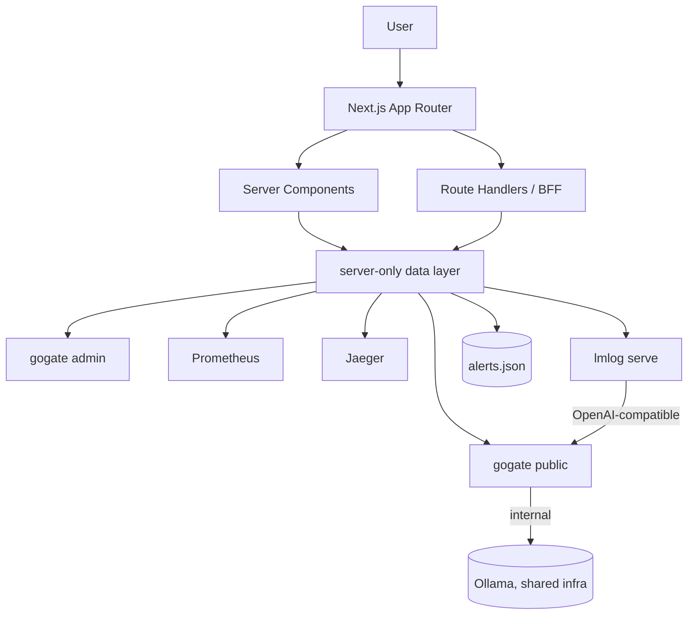
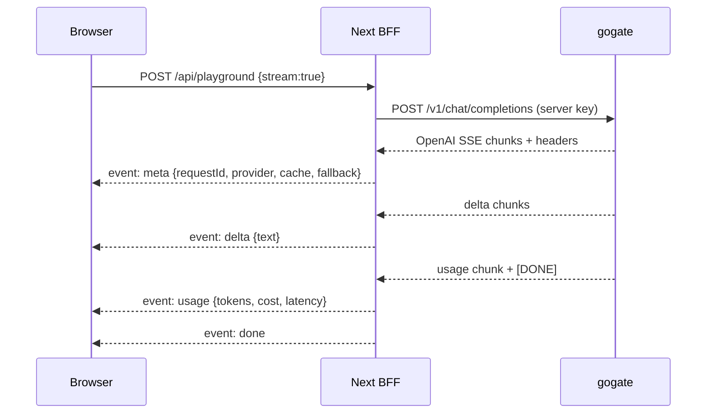

# Design

## Goals

1. One console for two independent backends: `gogate` (AI gateway) and `lmlog`
   (log intelligence).
2. Never expose admin tokens, upstream URLs or provider secrets to the browser.
3. Make the first paint useful: SSR for the initial dashboard, client components
   for live interaction.
4. Treat streaming, errors, permissions and degradation as first-class states.
5. Keep the stack conventional: Next.js App Router, TypeScript, Tailwind,
   shadcn-style primitives, TanStack Query, Recharts, Zod, RHF, Vitest, Playwright.

## Non-goals

- A general-purpose identity provider.
- Multi-region deployment, billing or Kubernetes.
- Storing prompts/responses in the console.
- Owning LLM infrastructure, Ollama containers or retry/rate-limit logic.
- A second log store or a RAG pipeline over raw log lines.

## System context



The browser only calls same-origin `/api/*`. Server Components call the same
server-only data layer directly, without an extra HTTP hop.

`ops-console` does not know about Ollama. AI explanations and chat are owned by
`lmlog`, which calls `gogate` over the OpenAI-compatible API; `gogate` is the only
service that talks to Ollama.

## Frontend layers

- `src/app/(console)/*` — route segments and page-level metadata.
- `src/components/*` — feature components and shadcn-style primitives.
- `src/lib/server/*` — server-only clients, auth, env validation, metrics,
  CSV, alerts and logging.
- `src/lib/schemas/*` — Zod contracts shared by BFF and client.
- `src/lib/client/*` — browser fetch wrapper and SSE parser.
- `src/proxy.ts` — nonce-based CSP and page-level auth redirects.

## Data flows

### Server-rendered first data

Dashboard, keys, requests, logs and snapshot pages fetch their initial payload in
server components (`src/lib/server/page-data.ts` for the latter three). TanStack
Query hydrates with those values and only fetches on refresh/filter changes.

### Dashboard

1. The server component parses `range` and calls `loadDashboard(range)`.
2. Prometheus range queries and instant queries run in parallel.
3. gogate admin `/usage` and `/tenants` run in parallel.
4. Results are merged into `DashboardData`; alert rules are evaluated.
5. The client hydrates the initial payload and refreshes via
   `/api/dashboard?range=...` every 15 seconds while the tab is visible.

PromQL is a fixed allowlist. The browser can choose a range, never an arbitrary
expression. If Prometheus is absent or unreachable, the response sets
`metricsAvailable=false`, includes a warning and keeps usage cards working.

### Playground stream



The BFF normalises upstream OpenAI SSE into a smaller protocol. It also computes
cost from `/admin/v1/prices`, marks fallback when the actual provider is not the
first provider in the chain, and propagates `X-Request-ID`. If the client aborts,
the abort signal cancels the upstream fetch.

### lmlog upload and progress

1. The browser posts multipart to `/api/lmlog/jobs` with CSRF.
2. The BFF forwards the streaming body to lmlog without buffering it in memory.
3. lmlog returns `202 {job_id}`.
4. The browser opens `EventSource('/api/lmlog/jobs/{id}/events')`.
5. The BFF proxies SSE and forwards `Last-Event-ID`.
6. lmlog replays retained events and then streams new progress events.

The BFF returns `204` when a terminal job is already fully replayed, which stops
`EventSource` from reconnecting in a loop.

### Requests and traces

The audit list comes from `/admin/v1/audit` with server-side filters (tenant,
model, status, cache, query, time). A record may contain `trace_id`; the console
fetches `/api/traces/{id}`, transforms Jaeger spans into a tree and renders a
waterfall. If tracing was disabled, the UI explains why and offers a time-scoped
Jaeger search link instead.

## Auth and permissions

- A single admin token and an optional viewer token.
- Login is constant-time compared, throttled in memory and returns an HMAC-signed
  session cookie.
- Session payload: `{ role, iat, exp, v }`. The cookie is httpOnly, SameSite=Lax,
  Secure when the configured origin is HTTPS.
- Mutations require an allowed `Origin`, same-origin `Sec-Fetch-Site` and a
  double-submit `console_csrf` cookie/header.
- Viewer can read dashboards, keys, logs, requests and run explain/chat.
  Viewer cannot use playground/compare, upload logs or mutate keys/quotas/alerts.
- The UI hides actions, but the route handlers enforce the role independently.

## Error model

Every BFF error is:

```json
{
  "error": {
    "code": "upstream_gogate_unavailable",
    "message": "Не удалось подключиться к gogate",
    "requestId": "…",
    "details": {}
  }
}
```

Upstream auth failures are mapped to `502` without leaking the token. Upstream
5xx responses are mapped to `502`; 4xx validation messages are passed through when
safe. Contract mismatches are logged and returned as
`upstream_<service>_contract`.

After an SSE stream has started, errors are sent as an `event: error` frame because
the HTTP status is already committed.

## Persistence

The console is stateless except for alert rules in
`CONSOLE_DATA_DIR/alerts.json`. Writes use a temporary file plus atomic rename and
an in-process queue. Rules are validated with Zod on read and write. This keeps
the deployment simple for a single console instance; it is not a distributed
database.

## UI system

- Dark-first neutral palette with an emerald accent; semantic success/warning/
  danger/info tokens.
- shadcn-style primitives built on Radix; no runtime CSS-in-JS.
- Tabular numbers and monospace IDs for operational data.
- Recharts with custom tooltips and fixed animation off for stable screenshots.
- Skeletons, empty states and degraded states are explicit.
- Command palette (`⌘K`), theme cookie, focusable controls and reduced-motion support.
- Markdown rendering uses `react-markdown` + `rehype-sanitize`; raw HTML is not
  trusted.

## Trade-offs

- **BFF instead of direct browser calls** adds one hop but keeps all secrets
  server-side and gives one error/CSRF/RBAC boundary.
- **Fixed PromQL** limits flexibility but removes an injection surface and keeps
  the dashboard predictable.
- **Daily usage** is coarser than a 15-minute window. The UI labels this clearly
  and prefers Prometheus counters for short ranges.
- **File-backed alerts** avoid a database dependency but are single-instance.
- **No prompt/response persistence** keeps the console privacy-preserving but
  means request detail cannot replay content.
- **Mock upstream E2E** is fast and deterministic, but real-service smoke tests
  remain useful before a release.
